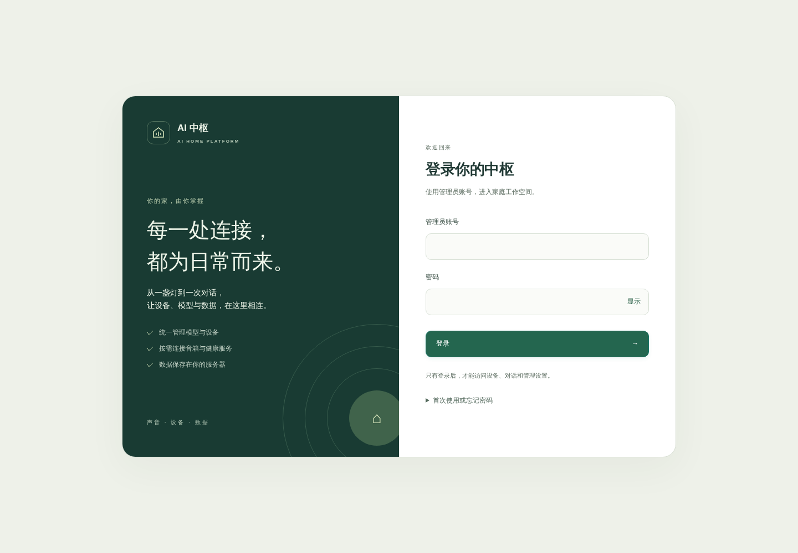

# Xiaomi AI Hub · AI 家庭中枢

把模型、家庭设备和多个终端接入同一个自托管中枢。支持网页管理、小爱音箱与原生 Android 客户端；健康服务可独立启用，数据与账号分开保存。

这是社区项目，与小米、OpenAI、Anthropic 无隶属关系。小米相关接口可能随固件或云端更新变化，接入和设备控制能力以实际型号与授权为准。



## 能做什么

- **模型管理**：集中配置多个上游，兼容 OpenAI Chat Completions / Responses 和 Anthropic Messages，切换默认路由，保留模型参数与请求统计。
- **家庭助手**：通过已授权工具查询设备、控制支持的米家设备、发送红外空调指令、创建定时任务；天气与自建 SearXNG 搜索可按需开启。
- **多终端**：网页、音箱和原生 Android 客户端连接自己的服务器；面板管理员登录、会话撤销及 CSRF 校验默认开启。
- **健康空间（可选）**：单独同步和分析自己的健康数据；中枢通过只读 API 访问，AI 读取权限默认关闭。

## 快速开始

需要 Docker Engine、Docker Compose **v2.24+**、Python **3.11+** 和 Git。端口默认只绑定本机回环地址，不需要先准备小米账号或 AI API Key。

```sh
git clone https://github.com/N21-Dev/xiaomi-ai-hub.git
cd xiaomi-ai-hub
python3 ops/setup.py init
python3 ops/setup.py build
python3 ops/setup.py admin
python3 ops/setup.py start
```

打开 <http://localhost:18765/login>，使用自己创建的管理员账号登录。**没有默认账号或密码**，新管理员密码至少 12 个字符。第一次使用先在“模型中枢”添加自己的模型上游，再按需在“连接设置”连接小米账号。普通模型管理和文字对话不要求连接音箱。

`init` 只创建本地配置、随机健康 API Key 和独立数据目录；检测到已有配置就停止，保留原内容。`admin` 交互读取密码，不把密码写入命令参数、仓库或日志；重设时会重启正在运行的中枢以撤销旧会话。`build` 首次需要访问镜像仓库和 Python 包索引。

同时启用健康空间时，在新目录中把初始化命令换为：

```sh
python3 ops/setup.py init --with-health
```

然后依次执行 build、admin、start。健康空间位于 <http://localhost:8321>，数据 API 使用初始化时生成的独立 API Key。详细步骤见[部署与账号](docs/DEPLOYMENT.md)、[配置说明](docs/CONFIGURATION.md)。

## 保护你的数据

本仓库仅包含通用源码、模拟测试和配置模板，不包含任何用户账号、模型 Key、健康记录、设备清单、部署历史、Cookie、数据库或 APK 签名密钥。初始公开版本使用独立提交历史。

运行数据位于 `data/bridge` 与 `data/health`；配置位于 `.env` 和 `config/*.env`，均被 Git 忽略。开启外部模型后，对话和明确授权的工具结果会发给你选择的上游；健康 AI 访问、天气查询和网页搜索分别需要启用。浏览器中的“清空对话”与 NAS 数据备份是不同操作，详见[隐私与数据流](docs/PRIVACY.md)。

面向局域网开放时，修改 `.env` 的 `BIND_ADDRESS`；公网入口请使用 HTTPS 反向代理和面板登录。健康服务使用独立 API Key，不能直接复用面板登录。不要将可读写数据目录、配置文件或健康端口直接放到公网。

## 开发与检查

```sh
python3 ops/audit_public.py
docker compose -f compose.dev.yaml build
docker compose -f compose.dev.yaml run --rm bridge-tests
docker compose -f compose.dev.yaml run --rm health-tests
```

后端测试禁网，使用临时数据库、模拟模型和模拟设备。浏览器检查需要 Node.js 22+ 和 Playwright，见[开发与验证](docs/DEVELOPMENT.md)。

## 目录

```text
services/xiaomi-ai-bridge/   中枢、模型网关、设备工具与面板
services/mi-health-hub/      独立健康服务与网页
apps/android/               原生 Android 客户端源码
config/                     通用模板及本地配置位置
ops/                        初始化、验证与发布辅助脚本
docs/                       部署、配置、隐私与开发说明
```

Android 需要自己的 SDK 和签名密钥，仓库不提供原部署者签名的安装包。构建步骤见 [Android README](apps/android/README.md)。

当前音箱接入仅支持小米中国区（`MI_REGION=cn`），健康统计业务日按北京时间计算。协议转换已覆盖文本、图片、流式输出和工具回合，具体模型仍受上游实现与能力限制。

欢迎提交 Issue 和 Pull Request；漏洞请通过 [Security advisories](https://github.com/N21-Dev/xiaomi-ai-hub/security/advisories/new) 私密报告，勿上传真实令牌或健康记录。参见 [贡献指南](CONTRIBUTING.md)、[安全策略](SECURITY.md)与[首次公开检查](docs/RELEASE-AUDIT.md)。

原创代码使用 [MIT License](LICENSE)。第三方组件及红外协议模块的许可说明见 [THIRD_PARTY_NOTICES.md](THIRD_PARTY_NOTICES.md)。
